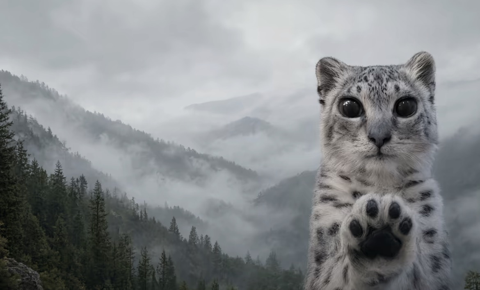

Mei Mei · Misty Peaks
---
Mei Mei the snow leopard cub on the Home and Instances pages. `scene.jpg` is the user-supplied picture;
`backdrop.jpg` is made from it: the part without Mei Mei, mirrored to fill the width, blurred and darkened,
for the other pages and dialogs.

Select **Mei Mei · Misty Peaks** in Settings → Appearance. The images are bundled; the theme needs no network requests.

## Preview

